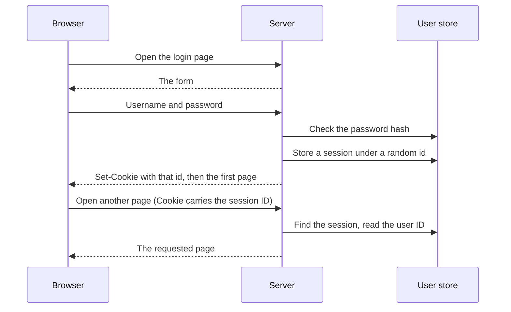
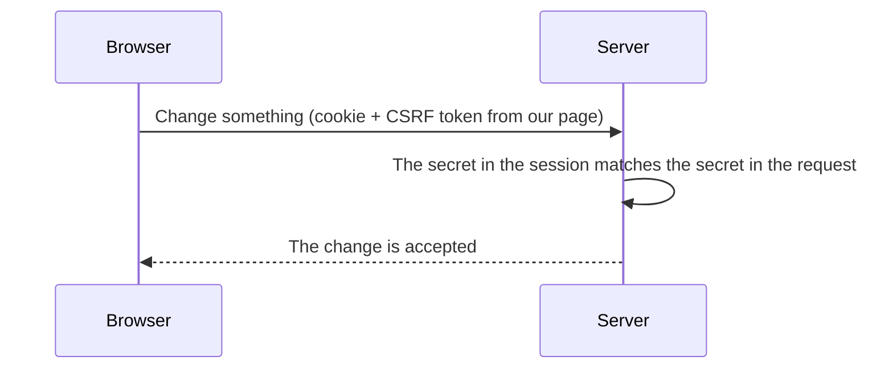
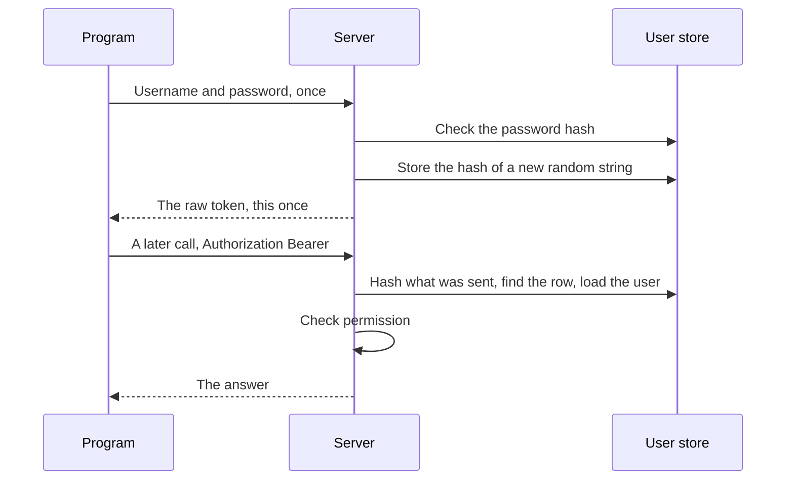
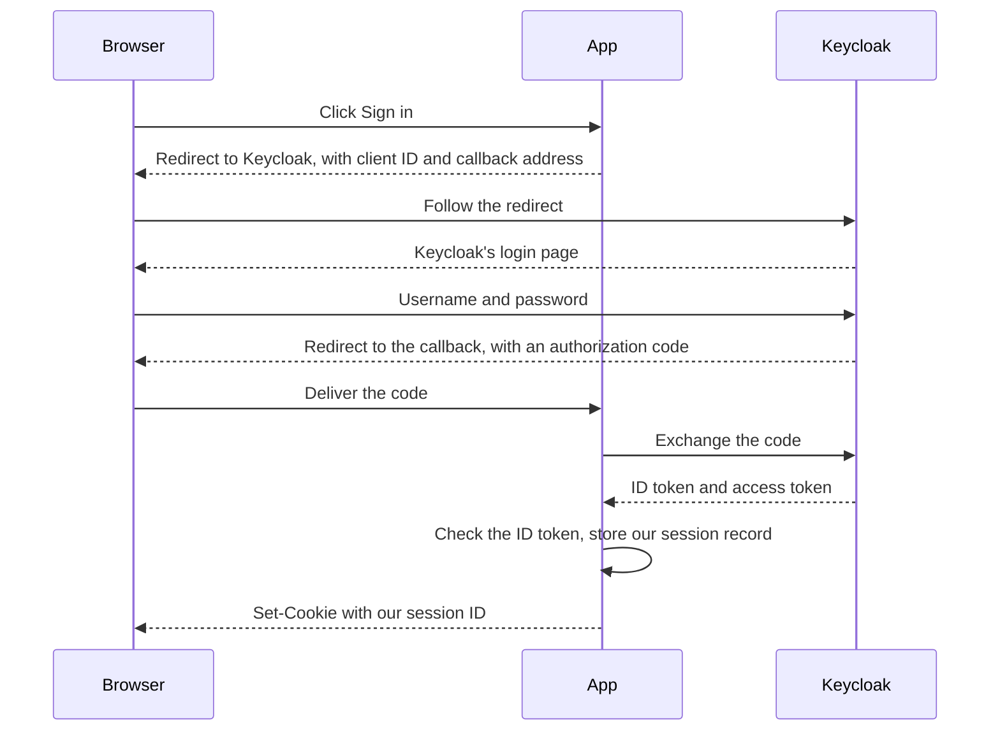
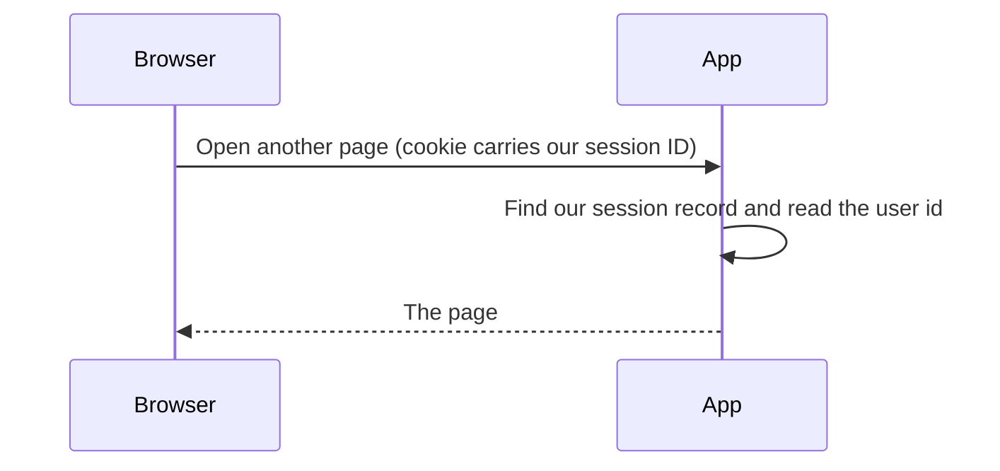
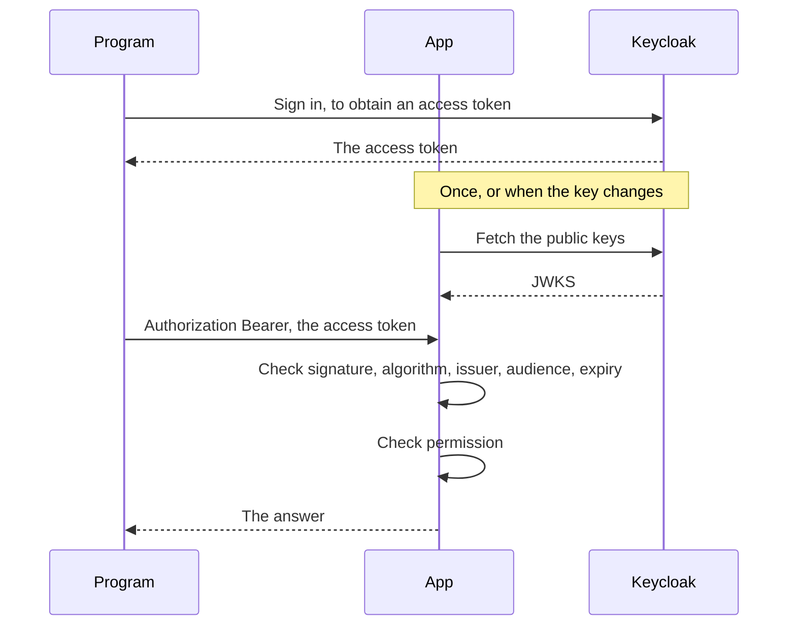

# Signing in, and how the server remembers

This note explains how a server knows who is calling after the password has been checked once.

HTTP treats every request as new. A successful login does not automatically apply to the next click. The server has to connect those requests itself.

This example uses two ways to do that:

- The browser sends a **session cookie**.
- An API caller, later in the note, sends a **bearer token**.

The note has two parts.

- **Part 1.** Our own server checks the password, then remembers the login.
- **Part 2.** Keycloak checks the password. Our app still creates its own session. The session cookie and the CSRF check stay.

## Structure

**[Part 1: The server checks the password](#part-1-the-server-checks-the-password)**

- [Why the next request is separate](#why-the-next-request-is-separate)
- [A session cookie](#a-session-cookie)
- [Sign-out](#sign-out)
- [An alternative: storing the session in a signed cookie](#an-alternative-storing-the-session-in-a-signed-cookie)
- [CSRF: the cookie sends itself](#csrf-the-cookie-sends-itself)
- [A second secret](#a-second-secret)
- [Calling the API directly](#calling-the-api-directly)
- [The API token](#the-api-token)
- [The two proofs](#the-two-proofs)

**[Part 2: Letting Keycloak check the password](#part-2-letting-keycloak-check-the-password)**

- [The browser is sent away](#the-browser-is-sent-away)
- [Exchanging the authorization code](#exchanging-the-authorization-code)
- [The page after Keycloak](#the-page-after-keycloak)
- [Our session and Keycloak's session](#our-session-and-keycloaks-session)
- [The access token on an API call](#the-access-token-on-an-api-call)
- [A form on our site that forwards the password](#a-form-on-our-site-that-forwards-the-password)

**[Appendix: when the wiring gets in the way](#appendix-when-the-wiring-gets-in-the-way)**

## Part 1: The server checks the password

In this part, our server stores a hash of the password and checks that hash at login. After the check succeeds, the server stores a session.

### Why the next request is separate

The user sends a username and a password. The server finds that user and checks the password hash. The check succeeds.

The user then opens another page. That click is a new request. The password is not in this request. HTTP does not add "this is the user who just logged in."

So the server keeps its own record of the login. That record is called a **session**. It is stored on the server.

The server stores the session ID in that record, as the key. The password is not stored again. It was already checked.

One session record looks like this:

| Field | Example | What it is for |
| --- | --- | --- |
| Session ID | `k3p9…` | The key. The cookie carries a copy of this, so the server can find the row. |
| User id | `7` | Which user logged in. |
| CSRF secret | `m2q8…` | A second value for that same visit. The CSRF section explains it. |
| Expires at | `2026-10-13 14:00 UTC` | When the server must stop accepting this session. |

The session is not a cookie. The cookie carries a copy of the session ID. The server keeps the whole row.

### A session cookie

The session ID in that row is random. In this example, the browser sends it back in a **cookie**.

A cookie is a small value the server asks the browser to store. After the password check succeeds, the login response includes `Set-Cookie` with the session ID. The browser stores that cookie. On later requests to this same site, the browser attaches it. The user does not copy it.

From then on, each request to this site includes that cookie. The server reads the session ID, finds the row, and reads the user id. That is how it knows who is logged in. If the cookie is missing, or the session ID does not match a valid, unexpired session, the server sends the user back to the login page.

The session ID is a **token**. A token is a value the caller sends so the server can check it.

> **Warning.** Anyone who has this cookie can use the server as user 7. The cookie must stay secret.

The cookie carries that ID, not the user id from the row. Suppose the cookie instead said `user_id=7`, and the server trusted that number with no lookup. Anyone could change `7` to `1` and be treated as a different user.

A cookie can also have these settings:

- **HttpOnly.** A script on the page cannot read the cookie.
- **Secure.** The browser sends the cookie only over HTTPS.
- **SameSite.** This controls whether the browser attaches the cookie when another website starts the request. The CSRF section uses this.

### Sign-out

Sign-out does two things:

1. It deletes the session on the server.
2. It clears the cookie in the browser.

Both steps are needed. After the session is deleted, a stolen copy of the cookie no longer matches a session. If the server only clears the cookie in this browser, the session still exists, and a stolen copy can still use it.

### An alternative: storing the session in a signed cookie

The design above stores a session record on the server. That record holds the user id. The cookie only carries the session ID, which is the label for the record.

Some applications skip the record. The cookie then has to carry the information the record would have held. In the simplest case, the cookie itself says who the user is, for example `user_id=7`.

That creates the editing problem from earlier. The browser can change `7` to `1`. If the server trusts the number, the browser has become a different user.

To stop that edit, the server **signs** the cookie. It calculates a signature from the cookie's contents and a secret that only the server knows, and it stores that signature in the cookie too. On the next request the server calculates the signature again. If the user id was changed, the signature no longer matches, and the server rejects the cookie.

A signature does not hide the user id. Anyone who can see the cookie can still read `user_id=7`. Hiding the value would be encryption, which is a different step. Signing lets the server detect changes and reject the modified cookie.

> **Warning.** Anyone who has this cookie can use the server as user 7. The signature does not change that. The cookie must stay secret.

Sign-out is weaker with this design. There is no session record to delete. The server can tell this browser to drop its cookie. A stolen copy can keep working until the expiry stored in the signed data, which the server must check. Removing or expiring the browser's cookie does not invalidate that copy.

The rest of this note does not use a signed cookie. It uses a session record on the server.

### CSRF: the cookie sends itself

The session cookie solves the problem from the start of this note. After login, the server can tell who is calling. It does not stop every attack on that cookie.

One attack is **CSRF**, cross-site request forgery. The browser attaches the cookie by itself. Another site can start a request that uses that fact.

A person is logged in, so the browser is holding the session cookie for our site. They then open some other site. That site has a form pointed at our server, for example a request to delete a record, and the form submits itself.

The browser sends a real POST to our server. The person did not click anything on our site. Whether our cookie is included depends on `SameSite`, and on whether the request counts as cross-site. When the cookie is included, the server finds the session and would perform the delete.

`SameSite` blocks some of those cases. This example does not rely on that. The next section adds a second secret.

### A second secret

That second secret is how this example stops the forged request. The other site does not know it, and the browser does not attach it on its own. The cookie is no longer the only proof on a write.

At login the server makes a random CSRF token and stores it in the session. This token serves a different purpose. It does not identify the user; the session already does that. It helps protect the request against forgery.

When the server renders a page, it also puts that same token into the HTML: a hidden field in a form, or a meta tag. A write that comes from our page sends the token back, in the form or in a header such as `X-CSRF-Token`. The server compares the two copies.

When the browser does attach the cookie, the browser's same-origin policy normally prevents the malicious site from reading our page, so it cannot obtain the CSRF token. The cookie may arrive, the token does not match, and the write is rejected.

This check belongs on requests that change something: `POST`, `PUT`, `PATCH`, and `DELETE`, when the caller is the session cookie. GET requests should not change application state, so a GET is not the place for this secret. Logout changes something (it ends the session), so logout needs the secret too.

### Calling the API directly

Now consider a script, a mobile app, or an API documentation page calling our API. In this example, these callers explicitly send a token instead of using our session cookie.

They have the same original problem. The password was checked once, and the next request must still say who is calling.

### The API token

The thing we hand that caller is another unique value, an **API token**. The token is the value. `Authorization: Bearer …` is only the header that carries it, the way a cookie carried the session ID. "Bearer" means possession is enough: whoever presents a valid token can use it. The caller does not send the password again.

The caller sends the username and password once, to a token endpoint. The server checks the password, creates a long random string, and returns that string. The caller stores it and puts it in the header on later requests. Nothing attaches that header automatically. A forged page does not get this CSRF trick for free, because the browser will not add the victim's bearer token on its own.

The token, like the session cookie, answers one question: who is calling. That is **authentication**.

A second question comes after it: what this person may do. They may be allowed to read a record and not allowed to delete it. That is **authorization**. The server asks this for a cookie request and for a bearer request.

Hiding the delete button only changes what the page shows. Someone can still send the delete. The server has to refuse it when this person is not allowed.

The database stores a hash of the token, not the token itself. A later request is checked by hashing whatever the caller sent and looking for that hash. If the database leaks, the hashes are not usable tokens.

Deleting that row ends the token. The next call with the same string fails, because the proof is the row.

A docs page such as Swagger does this only when it is configured to. One common setup is a box where you paste a bearer token. The page then sends that header.

### The two proofs

| | Session cookie | API token |
|--|----------------|-----------|
| The value | A random session ID | A random token string |
| Who stores the value | The browser, inside a cookie | The caller that asked for it |
| How it travels | The browser attaches the cookie | `Authorization: Bearer …` |
| What "valid" means | The ID names a session we still store | The hash matches a stored token |
| On a write | The CSRF token from our page, then the permission check | The permission check |

## Part 2: Letting Keycloak check the password

In Part 1 our app checked the password. When the check succeeded, the app stored a session record and sent the browser a cookie carrying the session ID. Later page requests found that record.

That puts the password check inside the application. Several applications can instead share one login service. That service can also keep one-time codes, passkeys, and account lockout in one place, so each application does not have to build them. **Keycloak** is that service. It is a separate site. Our app is a client of it. The person types the password on Keycloak's page. When our app has a login result it can trust, it creates the same kind of session record as in Part 1, and the browser carries our session ID in our cookie.

Our app still needs a result it can check, because it no longer saw the password. This way of getting that result is **OpenID Connect**. A maintained OpenID Connect library should do the exchange and the checks below. The sequence is the model, not steps to build by hand.

### The browser is sent away

A person opens our app and clicks Sign in. Our app does not return a password form. The response tells the browser to go to Keycloak, and the browser follows that redirect.

Keycloak has to know which application asked. The redirect carries a **client ID**, a name that identifies our app to Keycloak. It also carries the **callback address**, the address in our app where the browser should come back after login. Keycloak sends the browser there only when that address is one it expects for this client.

Keycloak shows its own login page. The password is entered on that page, so this flow never delivers the password to our app. After Keycloak accepts it, Keycloak sends the browser back to the callback address. The return trip includes an **authorization code**: a short-lived value that can be used once. The browser carries the code back to our app. Our backend will exchange it for the login result. The code itself is not the statement of who the person is.

### Exchanging the authorization code

The browser's job ends when it delivers that code to our callback. Our backend then calls Keycloak directly and presents the code. Keycloak answers with two tokens. The browser does not make this call.

The **ID token** is Keycloak's statement about the person who logged in. Our app has to check that statement before trusting it, in the same spirit as the signed cookie in Part 1: the statement must be intact, it must come from our Keycloak, and it must still be valid. A maintained library does that check. Our app then reads who the person is, stores a new session record under a new random session ID, and sends `Set-Cookie` with that ID. The browser is logged in to our app because of that cookie.

Keycloak's answer also includes an **access token**. That token is a credential for an API call. Our pages do not need it, because the session record is what later page requests will use. Receiving it during this exchange does not hand it to a script or a phone app. Those callers obtain an access token through their own login. The API section follows that path.

A real login adds two safeguards around this trip. `state` is a value our app creates when it starts the redirect and expects to see again on the callback, so this return trip belongs to the login we started. PKCE is a one-time secret held by the client that started the flow. Keycloak exchanges the authorization code only when that secret is presented with the code, so someone who merely sees the code cannot exchange it. Our library handles both. In this example our backend also authenticates itself to Keycloak during the exchange. PKCE does not authenticate the backend.

### The page after Keycloak

The person opens another page of our app. The browser attaches our cookie. Our app reads the session ID, finds its own session record, and reads the user id in that row. It does not ask Keycloak. It already checked the ID token at login and wrote the result into the record. This request only has to find that record.

The record includes the expiry from Part 1. This page request is accepted or refused by looking at that record. The access token is not part of the check. When the access token reaches its own expiry, our session record can still be there, so the person can still open our pages until our record expires or we delete it.

When the person submits a change, the browser is still proving who they are with our cookie. Another site can still cause the browser to send that cookie, which is the CSRF problem from Part 1. Our app still compares the CSRF secret stored in the session with the copy that came from our page.

The record tells us who the user is. It does not decide whether they may delete a record. Our app still makes that permission check before it performs the change.

### Our session and Keycloak's session

The login above created two sessions.

Keycloak stored a session of its own and set a cookie that the browser will send back to Keycloak. Our app stored a different session record and set the cookie that the browser will send back to our app. Each site looks up only the cookie addressed to it.

Keycloak's session is why a later Sign in can skip the password form. The person clicks Sign in, our app redirects the browser, and the browser attaches Keycloak's cookie on that visit. Keycloak finds its session, already knows who this is, and sends the browser back to our callback with a new authorization code. Our app still exchanges that code, still checks the ID token, and still creates its own session record. The skipped piece is the password page.

Sign-out of our app deletes our session record and clears our cookie. The next request to our app finds no session, so we send the person to Sign in. Keycloak's session is a separate record. It remains until Keycloak ends it or it expires. If we also want to end that shared login, we send the browser through Keycloak's logout. If we do not, the next Sign in can skip the password form again. Ending Keycloak's session does not delete the session record another application stored for itself. That application keeps its own record until it ends the record or the record expires.

### The access token on an API call

In Part 1 an API caller sent a random token, and our database stored the hash of that token. A request was checked by hashing the presented value and finding the hash.

Here our API accepts an **access token** that Keycloak issued. The caller first obtains that token from Keycloak, and later presents it to our API. Those are separate steps. A successful login in the caller's tool is not yet a call to our API.

A documentation page such as Swagger can be the caller, when it is configured for this login. The person signs in through the same browser redirect. The page keeps the access token from that login and, on later calls, sends `Authorization: Bearer …`. If the browser already holds Keycloak's session cookie, the password form can be skipped, for the reason in the previous section. Another configuration is still the box from Part 1, where someone pastes a token the page will send. The page uses whichever configuration it was given. The ID token is Keycloak's statement to our app about the login. The access token is the credential the API checks.

Our API can check the access token without storing a hash of it. The token contains fields, and a signature over those fields. A token in this form is a **JWT**. Part 1 used a signature so our server could detect that a cookie had been altered. The secret that made the signature stayed on our server, and our server calculated it again. An access token splits that work. Keycloak signs the token with a **private key**, and that key stays at Keycloak. Our API checks the signature with the matching **public key**. The public key can confirm a signature Keycloak made. It cannot produce a new signature that would pass the same check. Someone who changes a field inside the token breaks the signature, and our API rejects the token. Anyone who can see the token can still read the fields. Signing detects a change. It does not hide the contents.

The fields inside the token are called **claims**. Our API uses three of them as questions:

- The issuer answers who issued the token. It must be our Keycloak.
- The audience answers who the token was meant for. It must be this API.
- The expiry answers whether the token is still in its validity period. Past that time, the API rejects it.

The signature is tied to an algorithm. Our API allows a specific algorithm, so a token signed some other way does not pass just because a signature is present.

To check the signature, our API needs Keycloak's public key. Keycloak publishes its public keys at an address called **JWKS**. Our API fetches those keys and caches them. On a normal API call it uses the cached key, checks the token, and then makes the permission check from Part 1. It does not ask Keycloak whether this user is still signed in.

That is a consequence of checking the token and the cached key. A logout at Keycloak, or an account Keycloak has since disabled, does not change the signature or the claims already in the token. Those checks do not see the change. Until the expiry claim says the token is finished, the API can still accept it.

### A form on our site that forwards the password

We could keep a password form on our own site and have our server send the username and password on to Keycloak. That grant is the password grant, also called a direct access grant. Current OAuth guidance says it must not be used. Our server would see the password, which is what the redirect avoids, and the browser would never visit Keycloak, so Keycloak would not set its own session cookie.

### Appendix: when the wiring gets in the way

The browser and our server often use different addresses for the same Keycloak. The person opens `localhost` on a published port. Our server calls Keycloak by its internal name. The token says which address issued it, and that address has to be one we accept.

A fixed public hostname can make Keycloak mark its login cookie `Secure` while the site is still plain HTTP. The browser then drops the cookie, and Keycloak reports that the login cookie is missing.

Keycloak may also stop the person on an extra step, such as "finish your profile," when the account has no email. Our callback never runs until that step is done.

Reading a JWT is not the same as verifying it. Checking an RS256 signature requires a JWT library with the necessary cryptographic support.
