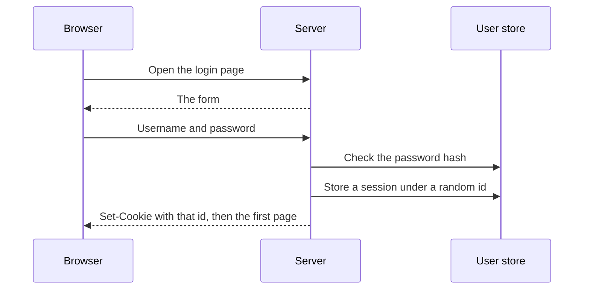
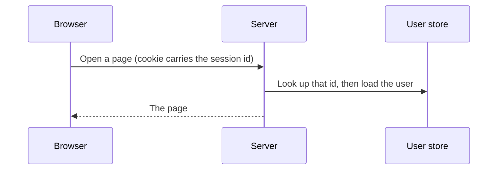
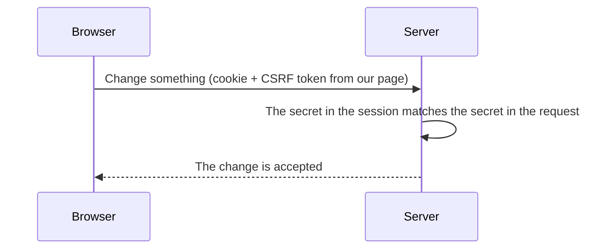
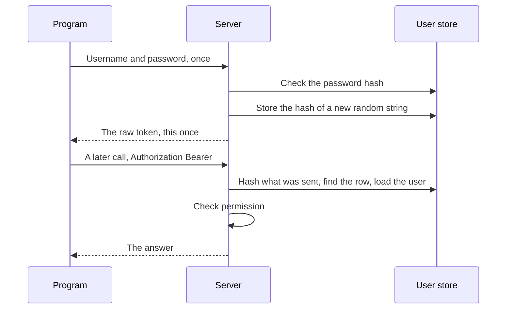
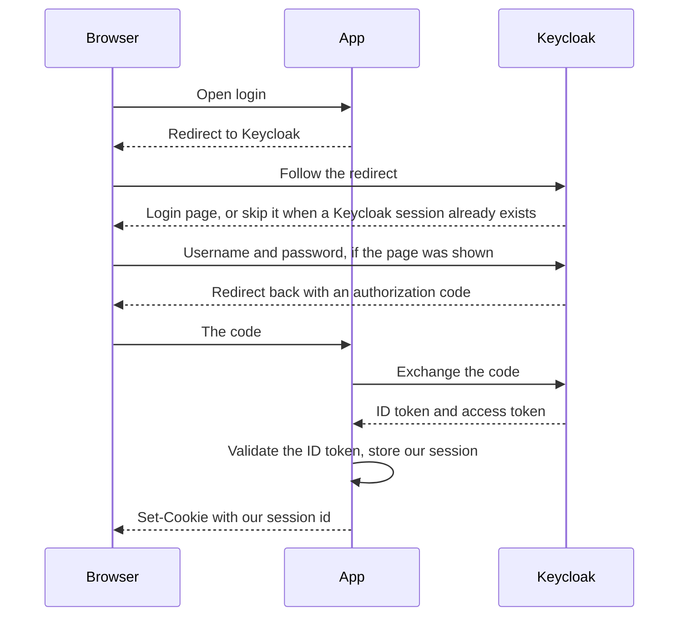
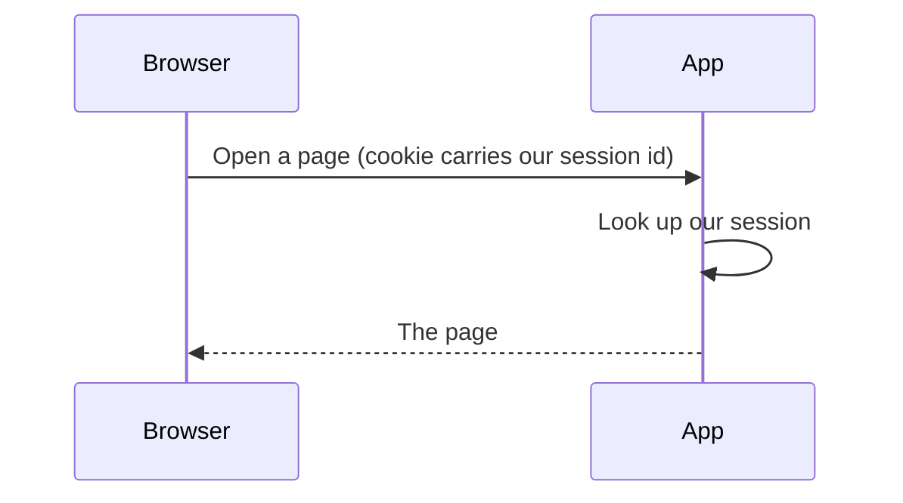
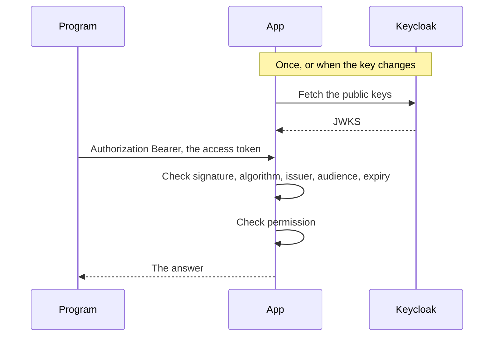

# Signing in, and how the server remembers

This note explains how a server knows who is calling after the password has been checked once.

HTTP treats every request as new. A successful login does not automatically apply to the next click. The server has to connect those requests itself.

This example uses two ways to do that:

- The browser sends a **session cookie**.
- An API caller, later in the note, sends a **bearer token**.

The note has two parts.

- **Part 1.** Our own server checks the password, then remembers the login.
- **Part 2.** Keycloak checks the password. Our app still creates its own session. The session cookie and the CSRF check stay.

## Structure

**[Part 1: The server checks the password](#part-1-the-server-checks-the-password)**

- [Why the next request is separate](#why-the-next-request-is-separate)
- [A session cookie](#a-session-cookie)
- [The request after login](#the-request-after-login)
- [An alternative: storing the session in a signed cookie](#an-alternative-storing-the-session-in-a-signed-cookie)
- [CSRF: the cookie sends itself](#csrf-the-cookie-sends-itself)
- [A second secret](#a-second-secret)
- [A caller that is not a browser](#a-caller-that-is-not-a-browser)
- [The API token](#the-api-token)
- [The two proofs](#the-two-proofs)

**[Part 2: Letting Keycloak check the password](#part-2-letting-keycloak-check-the-password)**

- [The browser is sent away](#the-browser-is-sent-away)
- [The page after Keycloak](#the-page-after-keycloak)
- [The access token on an API call](#the-access-token-on-an-api-call)
- [A form on our site that forwards the password](#a-form-on-our-site-that-forwards-the-password)

**[Appendix: when the wiring gets in the way](#appendix-when-the-wiring-gets-in-the-way)**

## Part 1: The server checks the password

In this part, our server stores a hash of the password and checks that hash at login. After the check succeeds, the server stores a session.

### Why the next request is separate

The user sends a username and a password. The server finds that user and checks the password hash. The check succeeds.

The user then opens another page. That click is a new request. The password is not in this request. HTTP does not add "this is the user who just logged in."

So the server keeps its own record of the login. That record is called a **session**. It is stored on the server. It says which user logged in, and it can hold anything else this visit needs.

The session is not a cookie. The next section adds the cookie. The cookie only points at the session.

### A session cookie

The next request has to find the right session. The server gives the session a random **session ID**.

- The ID is not the user.
- The ID is not the session.
- The ID is only the name of that session record.

The session ID is a **token**. A token is a value the caller sends so the server can check it. Anyone who has this session ID can use that session, so the ID must stay secret.

The browser has to send the ID back. In this example, it sends the ID in a **cookie**.

A cookie is a small value the server asks the browser to store. The server sends it with `Set-Cookie`. On later requests to this same site, the browser attaches the cookie. The user does not copy it.

Keep these three things separate:

- **Session:** the record stored on the server.
- **Session ID:** the random token that names that record.
- **Cookie:** how the browser stores the ID and sends it back.

The server reads the ID from the cookie and looks up the session. Suppose the cookie instead said `user_id=7`, and the server trusted that number with no lookup. Anyone could change `7` to `1` and be treated as a different user.

A cookie can also have these settings:

- **HttpOnly.** A script on the page cannot read the cookie.
- **Secure.** The browser sends the cookie only over HTTPS.
- **SameSite.** This controls whether the browser attaches the cookie when another website starts the request. The CSRF section uses this.

### The request after login

On this request the server does not check the password again. It does three steps:

1. Read the session ID from the cookie.
2. Find the session with that ID.
3. Load the user stored in that session.

If the cookie is missing, or the ID does not match a session, the server sends the user back to the login page.

Sign-out does two things:

1. It deletes the session on the server.
2. It clears the cookie in the browser.

Both steps are needed. After the session is deleted, a stolen copy of the cookie no longer matches a session. If the server only clears the cookie in this browser, the session still exists, and a stolen copy can still use it.

### An alternative: storing the session in a signed cookie

The design above stores a session record on the server. The cookie only carries the session ID.

Some applications skip that record. The cookie itself says who the user is, for example `user_id=7`.

That creates the editing problem from earlier. The browser can change `7` to `1`. If the server trusts the number, the browser has become a different user.

To stop that edit, the server **signs** the cookie. It calculates a signature from the cookie's contents and a secret that only the server knows, and it stores that signature in the cookie too. On the next request the server calculates the signature again. If the user id was changed, the signature no longer matches, and the server rejects the cookie.

A signature does not hide the user id. Anyone who can see the cookie can still read `user_id=7`. Hiding the value would be encryption, which is a different step. Signing only stops changes.

Sign-out is weaker with this design. There is no session record to delete. The server can tell this browser to drop its cookie. A copy that someone already stole still has a valid signature, so it keeps working until the cookie expires.

The rest of this note does not use a signed cookie. It uses a session record on the server.

### CSRF: the cookie sends itself

The useful part of the cookie is that the browser sends it by itself. That is also the hole.

Imagine the person is logged in, so the browser is holding the session cookie. They then open some other site. That site contains a form pointed at our server, for example "delete this record," and the form submits itself. The browser builds a real POST to our server. Whether our cookie rides along depends on `SameSite`, and on whether the request counts as cross-site. When the cookie does ride along, the server sees a valid session and would perform the delete. The person never clicked anything on our site.

That is **CSRF**, cross-site request forgery. Another site causes the browser to call ours, and the session cookie may ride along. `SameSite` blocks some of those attachments. It is not the check this example relies on. The next section still adds a secret of our own.

### A second secret

The cookie cannot be the only proof on a write. We need a second secret that the other site does not know, and that the browser will not attach on its own.

At login the server makes a random CSRF token and stores it in the session. This token serves a different purpose. It does not identify the user; the session already does that. It helps protect the request against forgery.

When the server renders a page, it also puts that same token into the HTML: a hidden field in a form, or a meta tag. A write that comes from our page sends the token back, in the form or in a header such as `X-CSRF-Token`. The server compares the two copies.

When the browser does attach the cookie, the other site still cannot read our HTML. Pages from one site cannot read pages from another. So it cannot copy the CSRF token into the forged form. The cookie may arrive, the token does not match, and the write is rejected.

This check belongs on requests that change something: `POST`, `PUT`, `PATCH`, and `DELETE`, when the caller is the session cookie. GET requests should not change application state, so a GET is not the place for this secret. Logout changes something (it ends the session), so logout needs the secret too.

### A caller that is not a browser

A script, a mobile app, or an API docs page can call the same server. In this example they are not walking through our HTML, so they do not pick up the session cookie from a page.

They have the same original problem. The password was checked once, and the next request must still say who is calling.

### The API token

The thing we hand that caller is another unique value, an **API token**. The token is the value. `Authorization: Bearer …` is only the header that carries it, the way a cookie carried the session ID. "Bearer" means possession is enough: whoever presents a valid token can use it. The caller does not send the password again.

The caller sends the username and password once, to a token endpoint. The server checks the password, creates a long random string, and returns that string. The caller stores it and puts it in the header on later requests. Nothing attaches that header automatically. A forged page does not get this CSRF trick for free, because the browser will not add the victim's bearer token on its own. Knowing who is calling is authentication. Deciding what they may do is authorization. That second check applies to a cookie request and a bearer request alike.

The database stores a hash of the token, not the token itself. A later request is checked by hashing whatever the caller sent and looking for that hash. If the database leaks, the hashes are not usable tokens.

Deleting that row ends the token. The next call with the same string fails, because the proof is the row.

A docs page such as Swagger does this only when it is configured to. One common setup is a box where you paste a bearer token. The page then sends that header. Hiding a button is not the permission check.

### The two proofs

| | Session cookie | API token |
|--|----------------|-----------|
| The value | A random session ID | A random token string |
| Who stores the value | The browser, inside a cookie | The caller that asked for it |
| How it travels | The browser attaches the cookie | `Authorization: Bearer …` |
| What "valid" means | The ID names a session we still store | The hash matches a stored token |
| On a write | The CSRF token from our page, then the permission check | The permission check |

## Part 2: Letting Keycloak check the password

The first half assumes our server is the one that checks the password. That works for one application. It gets awkward when several applications should share a login, or when the password should be checked by a service that also does one-time codes, passkeys, and account lockout.

**Keycloak** is that service. It is a separate site whose job is to log people in. Our application becomes a client of it. The password is typed on Keycloak's page. Our app still creates the session from Part 1, and the browser still carries our session ID in our cookie.

This way of logging in is **OpenID Connect**. The browser is sent to Keycloak and comes back with a one-time code. Our server exchanges that code, checks the login result, and only then creates the session. A maintained OpenID Connect library should do the exchange and the checks. The sequence below is the model, not a recipe to implement by hand.

### The browser is sent away

Our login link does not show a password form. It sends the browser to Keycloak. The redirect names our application, a client id.

Keycloak shows its own login page. If this browser already logged in to Keycloak, it skips the form. That is Keycloak's own session cookie, on Keycloak's site, separate from ours.

Keycloak then sends the browser back to our callback address with a one-time **authorization code**. The code is not the password, and it is not yet proof of who the user is. Our server sends the code to Keycloak. Keycloak returns an **ID token**. That token is the login result: who the person is. Keycloak also returns an **access token**. That one is a credential for calling an API, and the next section uses it. The exchange is the moment our server talks to Keycloak during login.

Our server validates the ID token, reads the user, stores a session under a new random ID, and sets our cookie. From here, Part 1 applies again.

A real login includes additional safeguards. `state` connects the callback to the login our app started. PKCE means the authorization code cannot be exchanged without an additional one-time secret held by the client that started the flow. Our OIDC library handles these mechanisms. In this example, our backend also authenticates itself to Keycloak during the exchange.

### The page after Keycloak

Keycloak is not called. The page uses our session, which has its own lifetime. The access token expiring does not end that session. CSRF still applies to a write, because the browser may still attach our cookie. The permission check still applies too.

Sign-out deletes our session and clears our cookie. If we also want to end the shared Keycloak login, we send the browser through Keycloak's logout flow. Otherwise, the next login to our app may skip the password form.

### The access token on an API call

An API caller still does not use our session cookie in this example. In Part 1 we minted a random string and stored its hash. With Keycloak, the caller presents the **access token** Keycloak issued. That token is the credential for the API. The ID token from the login is not reused for this.

The access token is a **JWT**: three parts, header, claims, and a signature. Our server checks it locally:

- the signature, using Keycloak's **public key**
- the algorithm, which must be one we allow
- the issuer, which must be our Keycloak
- the audience, which must be this API
- the expiry

The private key never leaves Keycloak. The public keys are published at a certificate address (JWKS). Our server fetches them and caches them, so a normal API call does not wait on Keycloak.

Local validation does not learn that the user has been signed out or disabled in Keycloak. Without an additional check, the API can continue accepting the token until it expires. Asking Keycloak on every request is possible. It is a round trip each time. This example trusts the checks above instead.

A docs page such as Swagger sends that token only when it is configured to. One configuration runs the same browser login, then stores the access token and sends it as `Authorization`. If the browser already has Keycloak's session cookie, that login form can be skipped. Another configuration is still the paste-a-token box from Part 1. The page does not pick one on its own.

### A form on our site that forwards the password

It is tempting to keep our own login form and have our server pass the username and password to Keycloak. That is the old password grant, also called a direct access grant. Current OAuth security guidance says this grant must not be used. Our server would receive the password, and the browser would never visit Keycloak, so Keycloak would not set its own session.

### Appendix: when the wiring gets in the way

The browser and our server often use different addresses for the same Keycloak. The person opens `localhost` on a published port. Our server calls Keycloak by its internal name. The token says which address issued it, and that address has to be one we accept.

A fixed public hostname can make Keycloak mark its login cookie `Secure` while the site is still plain HTTP. The browser then drops the cookie, and Keycloak reports that the login cookie is missing.

Keycloak may also stop the person on an extra step, such as "finish your profile," when the account has no email. Our callback never runs until that step is done.

Reading a JWT is not the same as verifying it. Checking an RS256 signature requires a JWT library with the necessary cryptographic support.
